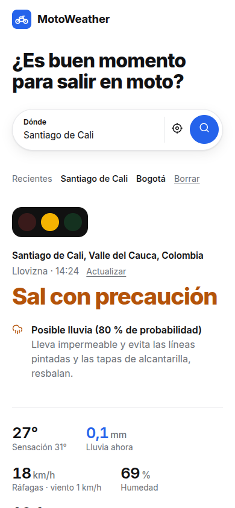
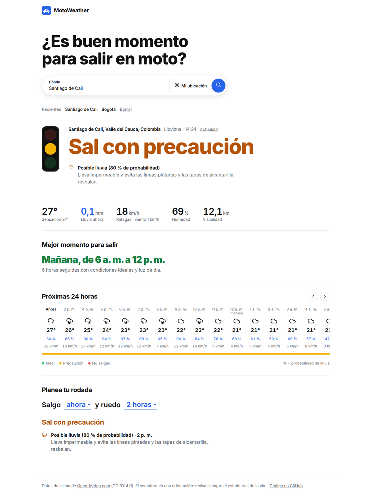

# MotoWeather

**¿Es buen momento para salir en moto?** Escribe tu ciudad y MotoWeather te dice si salir ahora, a qué hora conviene salir hoy y cómo se ve la ruta que tienes planeada. Revisa lluvia, ráfagas, tormentas, niebla, temperatura y si es de noche.

**[Abrir la app →](https://eliasgdev.github.io/moto-weather/)** · Gratis, sin registro y sin publicidad. Se instala en el celular como app (PWA).

<p align="center">
  
  &nbsp;&nbsp;
  
</p>

## Qué hace

- **Semáforo de ahora**: verde (listo para rodar), amarillo (sal con precaución) o rojo (mejor no salgas), con el **porqué** y un consejo concreto para cada riesgo.
- **Mejor momento para salir**: busca el tramo más largo de horas ideales con luz de día en las próximas 24 horas.
- **Próximas 24 horas**: hora por hora con temperatura, probabilidad de lluvia, ráfagas y su color.
- **Planea tu rodada**: eliges la hora de salida y la duración, y evalúa la peor hora del recorrido.
- **Búsqueda con sugerencias** de ciudades y municipios de todo el mundo, o **tu ubicación**.
- **Recientes** guardados en el dispositivo y **modo sin conexión** con el último pronóstico.
- Modo claro y oscuro automático, accesible por teclado y lector de pantalla.

## Reglas del semáforo

Cada hora se evalúa con estas reglas, y manda la condición más grave.

| Factor | Precaución (amarillo) | No salgas (rojo) |
|---|---|---|
| Tormenta eléctrica | — | Siempre |
| Hielo, nieve o lluvia helada | — | Siempre |
| Lluvia | ≥ 0,3 mm/h o probabilidad ≥ 50 % | ≥ 4 mm/h |
| Ráfagas de viento | ≥ 40 km/h | ≥ 60 km/h |
| Viento sostenido | ≥ 30 km/h | ≥ 45 km/h |
| Visibilidad | ≤ 1 km o niebla | ≤ 200 m |
| Frío (sensación térmica) | ≤ 10 °C | ≤ 3 °C |
| Calor | ≥ 33 °C | ≥ 38 °C |
| De noche | Siempre | — |
| Índice UV (de día) | ≥ 8 | — |

Las ráfagas pesan tanto como el viento sostenido: en moto, lo que te saca del carril es el golpe lateral. La probabilidad de lluvia sola nunca pone el semáforo en rojo, porque sin milímetros puede ser solo nubosidad. Los umbrales están en un solo lugar (`js/evaluar.js`) para ajustarlos fácilmente.

## Cómo está hecho

- **HTML, CSS y JavaScript sin frameworks ni dependencias**, con módulos ES.
- Datos de **[Open-Meteo](https://open-meteo.com/)**: pronóstico y geocodificación gratuitos, **sin API key**.
- **PWA**: manifiesto, service worker y último pronóstico guardado para abrir sin conexión.
- **Seguridad**: Content-Security-Policy estricta, sin `innerHTML` con datos externos, sin cookies ni rastreo. La fuente Inter va incluida en el repositorio, así que no se llama a terceros.

```
index.html
css/styles.css
js/
├── evaluar.js     # reglas del semáforo, mejor ventana y plan de rodada (funciones puras)
├── api.js         # Open-Meteo: búsqueda de lugares y pronóstico, con reintentos y tiempo límite
├── app.js         # interfaz
├── almacen.js     # recientes y último pronóstico en el dispositivo
└── iconos.js      # íconos SVG
tests/evaluar.test.js
sw.js · manifest.webmanifest
```

## Correrlo en local

```bash
git clone https://github.com/eliasgdev/moto-weather.git
cd moto-weather
npm start          # sirve la carpeta en http://localhost:8080
npm test           # pruebas de las reglas (node:test, sin instalar nada)
```

Hace falta un servidor porque los módulos ES no cargan abriendo `index.html` directo desde el disco.

Cada push a `main` corre las pruebas y publica en GitHub Pages.

## Aviso

El semáforo es una orientación basada en el pronóstico, no una garantía. Revisa siempre el estado real de la vía y tu equipo de protección.

## Licencia

Código bajo licencia MIT. Fuente Inter bajo SIL Open Font License (`fonts/LICENSE-Inter.txt`). Datos del clima de Open-Meteo.com bajo CC BY 4.0.

---

**Elias Gutierrez** · [github.com/eliasgdev](https://github.com/eliasgdev)
